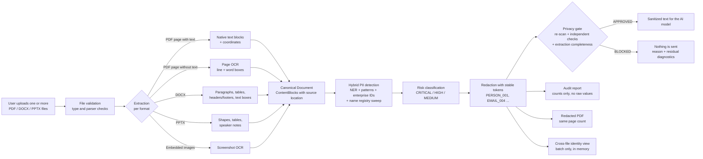
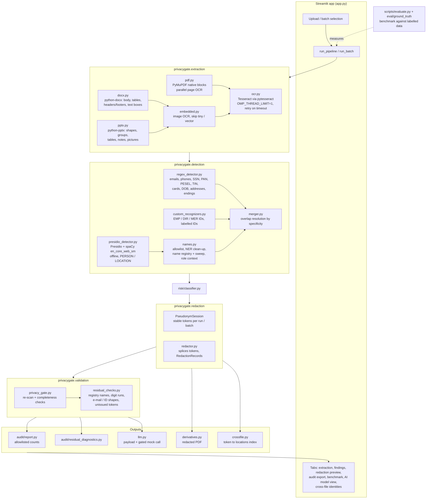

# PrivacyGate: solution blueprint and system architecture

PrivacyGate sits between business documents and an AI model. It extracts text from PDF
(native and scanned), DOCX and PPTX files, detects and classifies PII, replaces it with
stable tokens, and only lets sanitized text through when an independent privacy gate
approves it. Everything runs locally: no network calls and no API keys.

This describes `main` together with the open pull requests for the redacted PDF / AI model
view (#13) and the identifier controls (TIN, unlabelled PESEL, card issuer checks).

Detailed extraction and detection logic: [`extraction_and_detection.md`](extraction_and_detection.md).
Identifier false-positive controls: [`false_positive_controls.md`](false_positive_controls.md).
Measured results: [`../eval/results_after.md`](../eval/results_after.md).

## 1. Functional design (file ingestion → PII detection output)

**What each function guarantees**

| Function | Output | Guarantee |
|---|---|---|
| Extraction | `Document` of `ContentBlock`s | Every block keeps its source location: page/slide, paragraph, table row/column, shape path, image name, pixel or PDF boxes. A page or image whose OCR fails is recorded, never silently dropped. |
| Detection | `PIIEntity` spans (type, offsets, confidence, detectors) | Offsets point into the original block text, and detections from several detectors are merged deterministically. |
| Redaction | Sanitized `Document` + `RedactionRecord`s | The same person gets the same token across a document, or across a batch. The token mapping is never exported. |
| Privacy gate | `APPROVED` / `BLOCKED` + reason | Fails closed on residual PII, failed OCR or any error. A second pass cannot approve PII that only the independent checks caught. |
| Audit | JSON with counts by type, risk and location | No source text or values. |

## 2. System architecture (components and interactions)

**Interactions and data handling**

- One pipeline run works on in-memory objects. Uploaded files exist on disk only while
  processing and are deleted afterwards; OCR temp files are cleaned by pytesseract.
- The name registry built during detection is passed to the gate, so the gate can find
  leftover names without trusting the same NER model again.
- In a batch, `run_batch` merges the per-file registries and shares one `PseudonymSession`,
  so tokens line up across files. Names from other files are swept only as full names or
  dotted-initial forms.
- External dependencies are all local: PyMuPDF, python-docx, python-pptx, Pillow, Tesseract
  5.x, Presidio, spaCy `en_core_web_sm` (pinned in `uv.lock`), and Streamlit.
