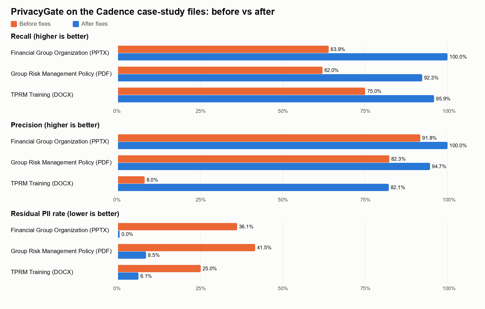

# PrivacyGate benchmark: before vs after

Before: baseline (before fixes) (2026-10-07). After: after fixes (main 163b517) (2026-10-11).
Both measured with `scripts/evaluate.py` against `eval/ground_truth/` (spaCy `en_core_web_sm`). After = main 163b517 (includes #11, #12, #14). Open PR #13 adds no detection changes: main + #13 measured identical.

| File | Recall | Precision | F1 | Residual PII rate | Gate 1 pass | Gate 2 passes |
|---|---|---|---|---|---|---|
| Cadence_Financial_Group_Organizational_Pack.pptx | 63.9% → **100.0%** (+36.1 pt) | 91.8% → **100.0%** (+8.2 pt) | 75.4% → **100.0%** | 36.1% → **0.0%** | APPROVED → APPROVED | APPROVED → APPROVED |
| Cadence_Group_Risk_Management_Policy__v6.0.pdf | 62.0% → **92.3%** (+30.3 pt) | 82.3% → **94.7%** (+12.4 pt) | 70.7% → **93.5%** | 41.5% → **8.5%** | BLOCKED → BLOCKED | APPROVED → BLOCKED |
| Cadence_TPRM_Training.docx | 75.0% → **95.9%** (+20.9 pt) | 8.0% → **82.1%** (+74.2 pt) | 14.4% → **88.5%** | 25.0% → **6.1%** | BLOCKED → APPROVED | APPROVED → APPROVED |
| **All files** | 62.6% → **93.3%** | 64.1% → **94.6%** | 63.4% → **94.0%** | 40.4% → **7.4%** | | |

## Recall by source channel

| File | Channel | Before | After |
|---|---|---|---|
| Cadence_Financial_Group_Organizational_Pack.pptx | native | 63.9% (78/122) | 100.0% (122/122) |
| Cadence_Group_Risk_Management_Policy__v6.0.pdf | ocr | 66.2% (563/850) | 98.9% (841/850) |
| Cadence_Group_Risk_Management_Policy__v6.0.pdf | image | 19.1% (16/84) | 25.0% (21/84) |
| Cadence_TPRM_Training.docx | native | 96.4% (27/28) | 100.0% (28/28) |
| Cadence_TPRM_Training.docx | image | 0.0% (0/8) | 90.5% (19/21) |

Image-channel counts can differ between runs: a value that was never extracted counts as one missed occurrence, while extracted image text counts every occurrence.

## Recall by location type

Body text, tables, unlabelled narrative prose and image-only content (ground truth `location_type`). Reports made before this split existed show —.

| File | Location | Before | After |
|---|---|---|---|
| Cadence_Financial_Group_Organizational_Pack.pptx | body | — | 100.0% (54/54) |
| Cadence_Financial_Group_Organizational_Pack.pptx | table | — | 100.0% (62/62) |
| Cadence_Financial_Group_Organizational_Pack.pptx | prose | — | 100.0% (6/6) |
| Cadence_Group_Risk_Management_Policy__v6.0.pdf | body | — | 100.0% (12/12) |
| Cadence_Group_Risk_Management_Policy__v6.0.pdf | table | — | 99.2% (763/769) |
| Cadence_Group_Risk_Management_Policy__v6.0.pdf | prose | — | 95.7% (66/69) |
| Cadence_Group_Risk_Management_Policy__v6.0.pdf | image | — | 25.0% (21/84) |
| Cadence_TPRM_Training.docx | table | — | 100.0% (28/28) |
| Cadence_TPRM_Training.docx | image | — | 90.5% (19/21) |

## Read with care

- **Cadence_TPRM_Training.docx** was APPROVED by the gate (APPROVED / APPROVED) while 3 ground-truth occurrence(s) remained unredacted.

## Runtime

| File | Before | After |
|---|---|---|
| Cadence_Financial_Group_Organizational_Pack.pptx | 4.8 s | 5.1 s |
| Cadence_Group_Risk_Management_Policy__v6.0.pdf | 148.1 s | 73.8 s |
| Cadence_TPRM_Training.docx | 32.7 s | 36.9 s |

---

# Full report (after)

Generated 2026-10-11 with `scripts/evaluate.py` on Windows 10.0.26300, Python 3.11.15; spaCy model `en_core_web_sm`; OMP_THREAD_LIMIT=1.

Recall counts every occurrence of a ground truth value in the extracted text (a value that was never extracted counts as one missed occurrence). Residual = occurrences with any character left unredacted. Precision counts detections; detections that only overlap rows marked uncertain are excluded. See `eval/README.md`.

## Summary

| File | Recall | Precision | F1 | Residual PII rate | Structure retention | Gate (1 pass) | Gate (2 passes) | Runtime |
|---|---|---|---|---|---|---|---|---|
| Cadence_Financial_Group_Organizational_Pack.pptx | 100.0% (122/122) | 100.0% (122/122) | 100.0% | 0.0% (0) | 100.0% | APPROVED | APPROVED | 5.1 s |
| Cadence_Group_Risk_Management_Policy__v6.0.pdf | 92.3% (862/934) | 94.7% (872/921) | 93.5% | 8.5% (79) | 100.0% | BLOCKED | BLOCKED | 73.8 s |
| Cadence_TPRM_Training.docx | 95.9% (47/49) | 82.1% (46/56) | 88.5% | 6.1% (3) | 100.0% | APPROVED | APPROVED | 36.9 s |
| **All files** | **93.3%** | **94.6%** | **94.0%** | **7.4%** | | | | |

## Recall by source channel

native = digitally native text, ocr = scanned page text, image = values inside embedded images/figures (image-only).

| File | native | ocr | image | Not extracted at all |
|---|---|---|---|---|
| Cadence_Financial_Group_Organizational_Pack.pptx | 100.0% (122/122) | — | — | 0 |
| Cadence_Group_Risk_Management_Policy__v6.0.pdf | — | 98.9% (841/850) | 25.0% (21/84) | 69 |
| Cadence_TPRM_Training.docx | 100.0% (28/28) | — | 90.5% (19/21) | 0 |

## Recall by location type

Where the value sits in the source (ground truth `location_type`): body text, tables, unlabelled narrative prose, or inside images/figures.

| File | body | table | prose | image |
|---|---|---|---|---|
| Cadence_Financial_Group_Organizational_Pack.pptx | 100.0% (54/54) | 100.0% (62/62) | 100.0% (6/6) | — |
| Cadence_Group_Risk_Management_Policy__v6.0.pdf | 100.0% (12/12) | 99.2% (763/769) | 95.7% (66/69) | 25.0% (21/84) |
| Cadence_TPRM_Training.docx | — | 100.0% (28/28) | — | 90.5% (19/21) |

## Cadence_Financial_Group_Organizational_Pack.pptx

| Entity type | Occurrences | Recall | Residual | Detections | Precision | F1 |
|---|---|---|---|---|---|---|
| EMAIL | 34 | 100.0% | 0 | 34 | 100.0% | 100.0% |
| LOCATION | 0 | n/a | 0 | 1 | 100.0% | n/a |
| PERSON | 54 | 100.0% | 0 | 53 | 100.0% | 100.0% |
| PHONE | 34 | 100.0% | 0 | 34 | 100.0% | 100.0% |

False positives by detected type: none. Ground truth rows: 122 (0 uncertain). Fuzzy (OCR-damaged) matches: 0. Blocks by extraction method: pptx_native 373.

## Cadence_Group_Risk_Management_Policy__v6.0.pdf

| Entity type | Occurrences | Recall | Residual | Detections | Precision | F1 |
|---|---|---|---|---|---|---|
| ADDRESS | 3 | 100.0% | 0 | 4 | 100.0% | 100.0% |
| DATE_OF_BIRTH | 5 | 40.0% | 3 | 2 | 100.0% | 57.1% |
| EMAIL | 166 | 87.4% | 22 | 163 | 98.7% | 92.7% |
| EMPLOYEE_ID | 198 | 96.0% | 8 | 191 | 99.5% | 97.7% |
| FINANCIAL_ACCOUNT | 2 | 100.0% | 0 | 2 | 100.0% | 100.0% |
| GOVERNMENT_ID | 12 | 66.7% | 4 | 9 | 100.0% | 80.0% |
| IP_ADDRESS | 3 | 0.0% | 3 | 0 | n/a | n/a |
| LOCATION | 0 | n/a | 0 | 25 | 16.0% | n/a |
| PERSON | 419 | 92.8% | 34 | 390 | 99.5% | 96.0% |
| PHONE | 126 | 97.6% | 5 | 154 | 85.0% | 90.8% |

False positives by detected type: EMAIL 2, EMPLOYEE_ID 1, LOCATION 21, PERSON 2, PHONE 23. Ground truth rows: 870 (20 uncertain). Fuzzy (OCR-damaged) matches: 30. Blocks by extraction method: ocr 1880.

## Cadence_TPRM_Training.docx

| Entity type | Occurrences | Recall | Residual | Detections | Precision | F1 |
|---|---|---|---|---|---|---|
| LOCATION | 0 | n/a | 0 | 3 | 0.0% | n/a |
| PERSON | 49 | 95.9% | 3 | 53 | 86.8% | 91.1% |

False positives by detected type: LOCATION 3, PERSON 7. Ground truth rows: 26 (0 uncertain). Fuzzy (OCR-damaged) matches: 1. Blocks by extraction method: docx_native 1285, embedded_image_ocr 742.
